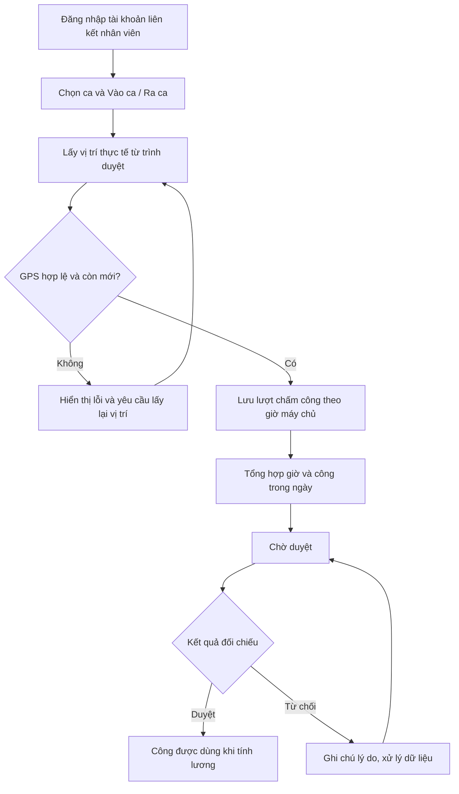

# Nghiệp vụ chấm công HRM

Tài liệu đối chiếu source ngày 04/10/2026. Phần 1–5 mô tả chức năng đang có; phần 6 tách rõ các lỗi đã sửa và quy tắc còn cần hoàn thiện.

## 1. Mục đích và tác nhân

Chấm công ghi nhận lúc nhân viên vào/ra ca, tổng hợp công trong ngày để người có quyền duyệt kiểm tra, sau đó cung cấp công đã duyệt cho tính lương.

| Tác nhân/quyền | Công việc |
| --- | --- |
| Người dùng có quyền chấm công cá nhân | Chấm công, xem lịch sử của mình, gửi đơn nghỉ và chọn ngày làm bù. |
| Người có quyền xem/duyệt chấm công | Đối chiếu giờ, ca, vị trí, sai số GPS, IP, ghi chú và quyết định duyệt hoặc từ chối. |
| Admin | Cấu hình ca và phân quyền; có toàn bộ quyền nghiệp vụ. |

Phòng ban không tự cấp quyền. Mật khẩu xác nhận nhập/xuất Excel là nghiệp vụ riêng, không thêm bước yêu cầu ảnh hay camera vào chấm công.

## 2. Quy trình đang chạy

1. Nhân viên mở **Chấm công**, chọn ca và **Vào ca**.
2. Hệ thống lấy GPS, kiểm tra tọa độ, accuracy và thời điểm lấy vị trí. Không lấy được vị trí thì không cho gửi.
3. Nhân viên xác nhận; hệ thống lấy lại GPS và lưu lượt vào, giờ máy chủ Việt Nam, ca, IP và khoảng cách nếu cấu hình địa điểm làm việc.
4. Khi kết thúc ca, nhân viên thực hiện tương tự với **Ra ca**.
5. Backend tổng hợp bảng công theo nhân viên và ngày; phần công thực tế chờ duyệt.
6. Người duyệt đối chiếu chi tiết, chấp nhận hoặc từ chối và ghi chú.
7. Tính lương đọc số công và giờ tăng ca từ các bảng công **đã duyệt**. Lượt GPS hoặc bảng công chờ duyệt không đồng nghĩa đã được trả lương.

Khi bổ sung lượt chấm công vào ngày đã duyệt/từ chối, phần công thực tế được gửi duyệt lại. Khi xóa hoặc từ chối lại một đơn nghỉ đã duyệt, bảng công được tính lại và chuyển sang chờ duyệt; quyết định duyệt nghỉ không thay thế quyết định duyệt công đi làm.

## 3. Dữ liệu cần phân biệt

| Thông tin | Ý nghĩa |
| --- | --- |
| Nhật ký vào/ra | Mỗi lần ghi nhận có thời gian, ca, GPS, accuracy, IP; dùng đối chiếu. Không có ảnh. |
| Giờ làm thường | Thời gian tổng hợp trong khung ca, theo cách tính ca hiện có. |
| Đi muộn / Về sớm | Số phút lệch so với giờ bắt đầu/kết thúc ca. |
| Giờ tăng ca | Thời gian trong ca được nhận diện là OT; không tự coi mọi giờ ra muộn là tăng ca. |
| Số công | Giá trị dùng tính lương theo ngày; khác với số giờ làm. Ca thường có giờ hữu ích dương giữ mức 0,5 hoặc 1 công hiện có; không tự chia tỷ lệ theo giờ. Thiếu lượt vào/ra hoặc giờ hữu ích bằng 0 thì không cộng công thực tế cho ca đó. |
| Trạng thái duyệt | Nháp, Chờ duyệt, Đã duyệt hoặc Từ chối. Chỉ Đã duyệt được đưa vào tính lương. |
| GPS accuracy | Sai số ước tính của vị trí do thiết bị cung cấp. |
| Khoảng cách | Khoảng cách đến địa điểm làm việc đã cấu hình; hiện chỉ đối chiếu, chưa bắt buộc nằm trong bán kính. |

## 4. Nghỉ phép và làm bù

| Loại nghỉ | Xử lý hiện tại |
| --- | --- |
| Phép năm | Kiểm tra số dư phép; khi được duyệt, ghi công phép tương ứng theo quy tắc hiện có. |
| Nghỉ không lương | Không cộng công cho phần ngày/ca nghỉ. |
| Nghỉ có làm bù | Ngày nghỉ không cộng công và không trừ phép năm; phải chọn lịch làm bù. |

Đơn làm bù phải chọn đủ ngày theo số ngày nghỉ làm việc; nghỉ nửa ngày chọn một ngày làm bù. Ngày làm bù phải ngoài khoảng nghỉ và không trùng lịch nghỉ/làm bù đang chờ duyệt hoặc đã duyệt của cùng nhân viên.

Đến ngày làm bù, nhân viên vẫn phải chấm công thực tế. Người duyệt đối chiếu với đơn liên quan rồi duyệt công. Duyệt đơn làm bù không tạo lượt vào/ra và không tự cộng công vào ngày làm bù.

Với nghỉ nửa ngày, nhân viên vẫn chấm công ca còn lại; công thực tế của ca đó cần được duyệt riêng với quyết định chấp thuận đơn nghỉ. Hiện lịch làm bù chưa có trạng thái đối soát “đã bù đủ/còn thiếu giờ”.

## 5. Ví dụ trình bày

**Đi làm bình thường:** nhân viên chọn ca hành chính, ghi Vào ca và Ra ca bằng GPS. Hệ thống hiển thị giờ, số phút muộn/sớm và công chờ duyệt. Người duyệt kiểm tra rồi xác nhận; công đã duyệt được đọc khi tính lương.

**Nghỉ một ngày có làm bù:** nhân viên đăng ký nghỉ thứ Hai và chọn thứ Bảy làm bù. Người có quyền duyệt chấp nhận đơn. Thứ Hai không có công cho ngày nghỉ. Thứ Bảy nhân viên chấm công thực tế, người duyệt đối chiếu ngày bù và duyệt; chỉ công thực tế được tính, không cộng thêm một lần công từ đơn nghỉ.

**Không cấp quyền vị trí:** hệ thống báo lỗi quyền GPS và chặn gửi. Không có tọa độ dự phòng; không yêu cầu ảnh để thay GPS.

## 6. Các lỗi đã sửa và quy tắc cần hoàn thiện

Đã sửa và bổ sung kiểm thử:

- Hai lượt vào/ra ngoài khung ca hoặc chỉ trong giờ nghỉ trưa có giờ hữu ích bằng 0: không cộng công thực tế.
- Thiếu lượt vào chiều: giữ trống giờ vào, không lấy lượt ra sáng thay thế; ca chiều không được cộng công.
- Xóa hoặc từ chối lại đơn nghỉ đã duyệt: bỏ công phép, tính lại nhật ký thực tế và yêu cầu duyệt lại. Công này chưa được đọc để tính lương cho đến khi được duyệt.
- Xóa đơn đang chờ duyệt không làm mất quyết định duyệt công độc lập đã có.

Các quy tắc chưa thay đổi:

| Điểm phát hiện trong source | Hướng hoàn thiện |
| --- | --- |
| Chưa kiểm tra chặt chuỗi/trùng lượt vào/ra; tổng hợp lấy lượt vào đầu và lượt ra cuối. | Chốt một cặp vào/ra mỗi ca hay cho phép nhiều phiên; kiểm tra lượt ra thiếu lượt vào, thao tác trùng và cách bổ sung quên chấm công. |
| Giờ hữu ích dương nhưng rất ngắn vẫn có mức 0,5/1 công theo quy tắc cũ. | Cần chốt quy đổi theo giờ hữu ích hay điều kiện đủ ca trước khi đổi công thức ảnh hưởng lương. Người duyệt phải kiểm tra tổng giờ, muộn/sớm trước khi chấp nhận. |
| Tổng hợp nhận diện các mã ca cố định; ca tùy chỉnh và ca qua đêm chưa được xử lý đầy đủ. | Tổng hợp theo ca đã cấu hình và ngày bắt đầu ca; xác định thời gian nghỉ giữa ca. |
| Làm bù hiện là lịch liên quan, chưa có đối soát đủ giờ. | Xác định số giờ phải bù, công được chấp nhận, giờ còn thiếu và trạng thái hoàn thành. |

Các mục trong bảng “chưa thay đổi” không được coi là đã hoàn tất. Bản sửa không tính lại hàng loạt bảng công/bảng lương cũ; những quy tắc sửa áp dụng khi nghiệp vụ tính lại công chạy.
